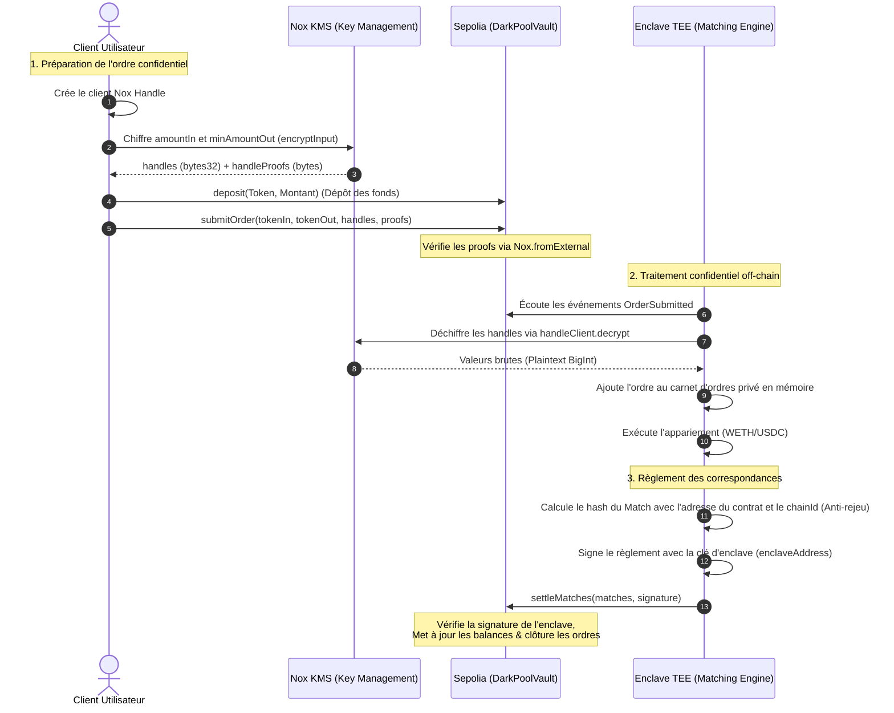

# MVP Dark Pool Décentralisé sur iExec Nox (Sepolia Testnet)

Ce document décrit et implémente un MVP (Minimum Viable Product) de **Dark Pool Décentralisé** fonctionnant sur le testnet Ethereum Sepolia. Ce protocole exploite les enclaves de calcul confidentiel (TEE - Intel TDX) et le Key Management Service (KMS) d'**iExec Nox** pour permettre l'appariement d'ordres d'échange de tokens ERC-20 (ex: WETH et USDC) en toute confidentialité grâce aux "confidential handles".

---

# Architecture & Flux de données

Le Dark Pool utilise un modèle d'exécution hybride : le stockage des fonds et la validation des preuves d'ordres sont gérés on-chain sur Sepolia via le contrat `DarkPoolVault` et la bibliothèque `Nox.sol`. Le carnet d'ordres et le moteur d'appariement (Matching Engine) sont exécutés off-chain au sein d'une enclave TEE (Intel TDX) d'iExec Nox.



### Principes Cryptographiques :
1. **Nox Handles (Pointeurs Confidentiels)** : Les données sensibles (`amountIn` et `minAmountOut`) sont converties côté client en pointeurs sécurisés (handles `bytes32`) par le SDK `@iexec-nox/handle`. Le contrat Solidity ne voit jamais les montants en clair on-chain.
2. **Vérification d'Entrée On-chain (`Nox.fromExternal`)** : Le contrat Solidity vérifie la validité des handles et des preuves soumis par le client pour s'assurer que le propriétaire de l'ordre dispose des droits sur ces handles chiffrés.
3. **Déchiffrement Confidentiel TEE** : L'enclave s'exécute dans une CVM Intel TDX. Seule l'enclave autorisée peut appeler `decrypt(handle)` auprès du KMS Nox pour récupérer les montants originaux en plaintext afin de faire fonctionner le moteur d'appariement.
4. **Signature de Règlement Enclave** : Le contrat `DarkPoolVault` n'accepte de modifier les balances internes que si la transaction de règlement est signée par l'adresse publique vérifiée de l'enclave (`enclaveAddress`).
5. **Protection contre le Rejeu** :
   - **Rejeu cross-contract/cross-chain** : Le hash signé par l'enclave inclut `block.chainid` et `address(this)`.
   - **Rejeu de transaction de règlement** : Chaque match contient un `salt` unique généré par l'enclave. Le contrat marque chaque hash de match comme traité (`processedMatches[matchHash] = true`).
   - **Vérification de solvabilité** : L'EVM réverte automatiquement les transferts si la balance du compte déposant devient inférieure à zéro.

---

# Dépendances & Installation

Pour installer les dépendances nécessaires côté client, smart contract et enclave, exécutez les commandes suivantes dans votre environnement de développement Node.js.

```bash
# Installation des dépendances client et enclave
npm install ethers@6.16.0 viem eciesjs dotenv

# Installation des versions spécifiques des librairies iExec Nox
npm install @iexec-nox/handle@0.1.0-beta.13 @iexec-nox/nox-protocol-contracts@0.2.4 --legacy-peer-deps
```

---

# Code Solidity

Voici le code complet du contrat `DarkPoolVault.sol`. Ce contrat gère les dépôts de tokens ERC-20, stocke les structures d'ordres confidentiels (via des types `euint256`), et exécute les règlements signés par l'enclave TEE.

```solidity
// SPDX-License-Identifier: MIT
pragma solidity ^0.8.35;

import "@openzeppelin/contracts/token/ERC20/IERC20.sol";
import "@openzeppelin/contracts/token/ERC20/utils/SafeERC20.sol";
import "@openzeppelin/contracts/utils/ReentrancyGuard.sol";
import "@openzeppelin/contracts/access/Ownable.sol";
import "@iexec-nox/nox-protocol-contracts/contracts/sdk/Nox.sol";

/**
 * @title DarkPoolVault
 * @dev Gère la garde des fonds et le règlement confidentiel des ordres validés par l'enclave iExec Nox.
 */
contract DarkPoolVault is ReentrancyGuard, Ownable {
    using SafeERC20 for IERC20;

    address public enclaveAddress;
    uint256 public nextOrderId;

    struct Order {
        address owner;
        address tokenIn;
        address tokenOut;
        euint256 amountIn;
        euint256 minAmountOut;
        bool isSettled;
    }

    struct Match {
        uint256 orderId1;
        uint256 orderId2;
        address user1;
        address user2;
        address token1; // Token vendu par user1 et acheté par user2
        address token2; // Token vendu par user2 et acheté par user1
        uint256 amount1To2; // Montant de token1 transféré à user2
        uint256 amount2To1; // Montant de token2 transféré à user1
        uint256 salt; // Nonce unique généré par l'enclave pour empêcher le rejeu du match
    }

    // Balances internes : utilisateur => adresse du token => solde disponible
    mapping(address => mapping(address => uint256)) public balances;
    
    // Registre des ordres soumis
    mapping(uint256 => Order) public orders;
    
    // Suivi des correspondances réglées pour éviter le rejeu
    mapping(bytes32 => bool) public processedMatches;

    event Deposit(address indexed user, address indexed token, uint256 amount);
    event Withdrawal(address indexed user, address indexed token, uint256 amount);
    event OrderSubmitted(
        uint256 indexed orderId,
        address indexed owner,
        address tokenIn,
        address tokenOut,
        bytes32 amountInHandle,
        bytes32 minAmountOutHandle
    );
    event MatchSettled(
        uint256 indexed orderId1,
        uint256 indexed orderId2,
        address user1,
        address user2,
        address token1,
        address token2,
        uint256 amount1To2,
        uint256 amount2To1
    );
    event EnclaveAddressUpdated(address indexed oldAddress, address indexed newAddress);

    constructor(address _enclaveAddress) Ownable(msg.sender) {
        require(_enclaveAddress != address(0), "DarkPoolVault: Invalid enclave address");
        enclaveAddress = _enclaveAddress;
    }

    /**
     * @dev Met à jour l'adresse de signature de l'enclave (rotation de clé/upgrade).
     */
    function updateEnclaveAddress(address _newEnclaveAddress) external onlyOwner {
        require(_newEnclaveAddress != address(0), "DarkPoolVault: Invalid address");
        emit EnclaveAddressUpdated(enclaveAddress, _newEnclaveAddress);
        enclaveAddress = _newEnclaveAddress;
    }

    /**
     * @dev Dépose des tokens ERC-20 dans le vault pour le trading confidentiel.
     */
    function deposit(address token, uint256 amount) external nonReentrant {
        require(amount > 0, "DarkPoolVault: Amount must be greater than 0");
        balances[msg.sender][token] += amount;
        IERC20(token).safeTransferFrom(msg.sender, address(this), amount);
        emit Deposit(msg.sender, token, amount);
    }

    /**
     * @dev Retire des tokens ERC-20 du vault vers le portefeuille utilisateur.
     */
    function withdraw(address token, uint256 amount) external nonReentrant {
        require(amount > 0, "DarkPoolVault: Amount must be greater than 0");
        require(balances[msg.sender][token] >= amount, "DarkPoolVault: Insufficient balance");
        balances[msg.sender][token] -= amount;
        IERC20(token).safeTransfer(msg.sender, amount);
        emit Withdrawal(msg.sender, token, amount);
    }

    /**
     * @dev Soumet un ordre confidentiel. Les montants sont cryptés sous forme de handles Nox.
     */
    function submitOrder(
        address tokenIn,
        address tokenOut,
        externalEuint256 amountInExternal,
        bytes calldata amountInProof,
        externalEuint256 minAmountOutExternal,
        bytes calldata minAmountOutProof
    ) external returns (uint256) {
        // Convertit les poignées externes et vérifie les preuves de possession
        euint256 amountIn = Nox.fromExternal(amountInExternal, amountInProof);
        euint256 minAmountOut = Nox.fromExternal(minAmountOutExternal, minAmountOutProof);

        uint256 orderId = nextOrderId++;
        orders[orderId] = Order({
            owner: msg.sender,
            tokenIn: tokenIn,
            tokenOut: tokenOut,
            amountIn: amountIn,
            minAmountOut: minAmountOut,
            isSettled: false
        });

        emit OrderSubmitted(
            orderId,
            msg.sender,
            tokenIn,
            tokenOut,
            externalEuint256.unwrap(amountInExternal),
            externalEuint256.unwrap(minAmountOutExternal)
        );

        return orderId;
    }

    /**
     * @dev Exécute un ensemble de règlements d'ordres appariés. Seule l'enclave TEE autorisée peut signer ce règlement.
     */
    function settleMatches(Match[] calldata matches, bytes calldata signature) external nonReentrant {
        // Reconstruction du hash de message avec chainid et address(this) contre le rejeu multi-contrats/réseaux
        bytes32 messageHash = keccak256(abi.encode(block.chainid, address(this), matches));
        bytes32 ethSignedMessageHash = keccak256(abi.encodePacked("\x19Ethereum Signed Message:\n32", messageHash));

        // Récupération de l'adresse du signataire
        address signer = recoverSigner(ethSignedMessageHash, signature);
        require(signer == enclaveAddress, "DarkPoolVault: Invalid enclave signature");

        for (uint256 i = 0; i < matches.length; i++) {
            Match calldata m = matches[i];

            // Création d'un hash unique pour le match pour empêcher le rejeu de la signature
            bytes32 matchHash = keccak256(abi.encode(
                m.orderId1, m.orderId2, m.user1, m.user2,
                m.token1, m.token2, m.amount1To2, m.amount2To1, m.salt
            ));
            require(!processedMatches[matchHash], "DarkPoolVault: Match already processed");
            processedMatches[matchHash] = true;

            Order storage o1 = orders[m.orderId1];
            Order storage o2 = orders[m.orderId2];

            // Validations de cohérence d'ordre
            require(o1.owner == m.user1, "DarkPoolVault: User1 mismatch");
            require(o2.owner == m.user2, "DarkPoolVault: User2 mismatch");
            require(!o1.isSettled, "DarkPoolVault: Order1 already settled");
            require(!o2.isSettled, "DarkPoolVault: Order2 already settled");

            // Exécution des transferts de fonds internes (revert si solde insuffisant)
            balances[m.user1][m.token1] -= m.amount1To2;
            balances[m.user2][m.token1] += m.amount1To2;

            balances[m.user2][m.token2] -= m.amount2To1;
            balances[m.user1][m.token2] += m.amount2To1;

            // Clôture des ordres appariés
            o1.isSettled = true;
            o2.isSettled = true;

            emit MatchSettled(
                m.orderId1,
                m.orderId2,
                m.user1,
                m.user2,
                m.token1,
                m.token2,
                m.amount1To2,
                m.amount2To1
            );
        }
    }

    function recoverSigner(bytes32 _ethSignedMessageHash, bytes memory _signature) public pure returns (address) {
        (bytes32 r, bytes32 s, uint8 v) = splitSignature(_signature);
        return ecrecover(_ethSignedMessageHash, v, r, s);
    }

    function splitSignature(bytes memory sig) public pure returns (bytes32 r, bytes32 s, uint8 v) {
        require(sig.length == 65, "DarkPoolVault: Invalid signature length");
        assembly {
            r := mload(add(sig, 32))
            s := mload(add(sig, 64))
            v := byte(0, mload(add(sig, 96)))
        }
    }
}
```

---

# Code de l'Enclave Nox

Le script TypeScript suivant s'exécute de façon isolée au sein de l'enclave TEE (Intel TDX). Il écoute les ordres soumis sous forme de handles, les déchiffre de façon sécurisée en mémoire via le SDK `createEthersHandleClient`, maintient le carnet d'ordres privé, calcule les correspondances et signe la transaction de règlement.

```typescript
import { ethers } from "ethers";
import { createEthersHandleClient } from "@iexec-nox/handle";
import * as dotenv from "dotenv";

dotenv.config();

const PROVIDER_URL = process.env.SEPOLIA_PROVIDER_URL || "";
const ENCLAVE_PRIVATE_KEY = process.env.ENCLAVE_PRIVATE_KEY || "";
const VAULT_ADDRESS = process.env.VAULT_ADDRESS || "";

if (!PROVIDER_URL || !ENCLAVE_PRIVATE_KEY || !VAULT_ADDRESS) {
  console.error("Missing required environment variables.");
  process.exit(1);
}

// ABI minimale du contrat DarkPoolVault actualisée pour utiliser les handles
const VAULT_ABI = [
  "event OrderSubmitted(uint256 indexed orderId, address indexed owner, address tokenIn, address tokenOut, bytes32 amountInHandle, bytes32 minAmountOutHandle)",
  "function settleMatches((uint256,uint256,address,address,address,address,uint256,uint256,uint256)[] matches, bytes signature) external",
  "function balances(address user, address token) view returns (uint256)"
];

const provider = new ethers.JsonRpcProvider(PROVIDER_URL);
const wallet = new ethers.Wallet(ENCLAVE_PRIVATE_KEY, provider);
const vaultContract = new ethers.Contract(VAULT_ADDRESS, VAULT_ABI, wallet);

let handleClient: any;

interface Order {
  id: number;
  owner: string;
  tokenIn: string;
  tokenOut: string;
  amountIn: bigint;
  minAmountOut: bigint;
}

const privateOrderBook: Order[] = [];

/**
 * Traite et déchiffre un ordre reçu via l'événement Solidity en utilisant le SDK Nox.
 */
async function processIncomingOrder(
  orderId: bigint, 
  owner: string, 
  tokenIn: string,
  tokenOut: string,
  amountInHandle: string, 
  minAmountOutHandle: string
) {
  try {
    console.log(`[TEE] Nouvel ordre détecté: ID ${orderId.toString()}`);

    // Déchiffrement des handles en clair via le Nox KMS
    console.log("[TEE] Déchiffrement du handle amountIn...");
    const amountInResult = await handleClient.decrypt(amountInHandle);
    
    console.log("[TEE] Déchiffrement du handle minAmountOut...");
    const minAmountOutResult = await handleClient.decrypt(minAmountOutHandle);

    const amountIn = BigInt(amountInResult.value);
    const minAmountOut = BigInt(minAmountOutResult.value);

    console.log(`[TEE] Ordre ID ${orderId.toString()} déchiffré off-chain:`);
    console.log(` - Token In : ${tokenIn}`);
    console.log(` - Token Out : ${tokenOut}`);
    console.log(` - Montant In : ${amountIn.toString()}`);
    console.log(` - Min Montant Out : ${minAmountOut.toString()}`);

    // Ajout au carnet d'ordres privé
    privateOrderBook.push({
      id: Number(orderId),
      owner: owner,
      tokenIn: tokenIn,
      tokenOut: tokenOut,
      amountIn: amountIn,
      minAmountOut: minAmountOut
    });

    // Lancement du matching engine
    await runMatchingEngine();
  } catch (error) {
    console.error(`[TEE] Erreur de traitement de l'ordre ${orderId.toString()}:`, error);
  }
}

/**
 * Moteur d'appariement en mémoire (Matching Engine).
 */
async function runMatchingEngine() {
  console.log("[TEE] Moteur d'appariement en cours d'exécution...");

  for (let i = 0; i < privateOrderBook.length; i++) {
    for (let j = i + 1; j < privateOrderBook.length; j++) {
      const orderA = privateOrderBook[i];
      const orderB = privateOrderBook[j];

      // Vérification de l'appariement des paires de tokens
      if (
        orderA.tokenIn.toLowerCase() === orderB.tokenOut.toLowerCase() &&
        orderA.tokenOut.toLowerCase() === orderB.tokenIn.toLowerCase()
      ) {
        // Vérification de compatibilité des prix limites
        if (
          orderA.amountIn >= orderB.minAmountOut &&
          orderB.amountIn >= orderA.minAmountOut
        ) {
          console.log(`[TEE] Match détecté entre l'ordre ${orderA.id} et ${orderB.id}`);

          // Retrait des ordres
          privateOrderBook.splice(j, 1);
          privateOrderBook.splice(i, 1);

          // Règlement
          await settleMatchedPair(orderA, orderB);
          return;
        }
      }
    }
  }
}

/**
 * Signe et soumet le règlement du match.
 */
async function settleMatchedPair(orderA: Order, orderB: Order) {
  const salt = ethers.toBigInt(ethers.randomBytes(32));
  const network = await provider.getNetwork();
  const chainId = network.chainId;

  const matchDetails = {
    orderId1: orderA.id,
    orderId2: orderB.id,
    user1: orderA.owner,
    user2: orderB.owner,
    token1: orderA.tokenIn,
    token2: orderB.tokenIn,
    amount1To2: orderA.amountIn,
    amount2To1: orderB.amountIn,
    salt: salt
  };

  const matchesArray = [
    [
      matchDetails.orderId1,
      matchDetails.orderId2,
      matchDetails.user1,
      matchDetails.user2,
      matchDetails.token1,
      matchDetails.token2,
      matchDetails.amount1To2,
      matchDetails.amount2To1,
      matchDetails.salt
    ]
  ];

  const matchesAbiString = "tuple(uint256 orderId1, uint256 orderId2, address user1, address user2, address token1, address token2, uint256 amount1To2, uint256 amount2To1, uint256 salt)[]";
  const encodedData = ethers.AbiCoder.defaultAbiCoder().encode(
    ["uint256", "address", matchesAbiString],
    [chainId, VAULT_ADDRESS, matchesArray]
  );
  const messageHash = ethers.keccak256(encodedData);

  // Signature du hash par la clé de l'enclave
  const signature = await wallet.signMessage(ethers.getBytes(messageHash));

  console.log(`[TEE] Signature de règlement générée par l'enclave : ${signature}`);

  try {
    const tx = await vaultContract.settleMatches(matchesArray, signature, {
      gasLimit: 500000
    });
    console.log(`[TEE] Transaction de règlement envoyée. Hash: ${tx.hash}`);
    await tx.wait();
    console.log("[TEE] Règlement validé on-chain avec succès !");
  } catch (error) {
    console.error("[TEE] Échec de la soumission de la transaction de règlement:", error);
  }
}

async function init() {
  console.log("Initialisation du client Nox Handle Ethers...");
  handleClient = await createEthersHandleClient(wallet as any);

  console.log("[TEE] Lancement de l'écouteur d'événements d'ordres sur Sepolia...");
  vaultContract.on(
    "OrderSubmitted", 
    (
      orderId: bigint, 
      owner: string, 
      tokenIn: string, 
      tokenOut: string, 
      amountInHandle: string, 
      minAmountOutHandle: string
    ) => {
      processIncomingOrder(orderId, owner, tokenIn, tokenOut, amountInHandle, minAmountOutHandle);
    }
  );
}

init().catch(console.error);
```

---

# Script Client (Frontend)

Ce script frontend TypeScript démontre comment interagir avec le protocole iExec Nox. Il prépare et chiffre l'ordre via le SDK Nox, effectue le dépôt de tokens (`deposit`), et soumet l'ordre chiffré à la blockchain Sepolia sous forme de handles et de proofs.

```typescript
import { createWalletClient, custom, parseEther, keccak256, encodeAbiParameters, parseAbiParameters } from "viem";
import { sepolia } from "viem/chains";
import { createViemHandleClient } from "@iexec-nox/handle";
import { ethers } from "ethers";

// Configuration des adresses de tokens ERC-20 sur Sepolia
const WETH_ADDRESS = "0x7b79995e5f793A07Bc00c21412e50Ecae098E7f9"; // Exemple Sepolia WETH
const USDC_ADDRESS = "0x94a9D45055024818746271C44985284758a8C77e"; // Exemple Sepolia USDC
const VAULT_ADDRESS = "0xVotreAdresseVaultIci";

const walletClient = createWalletClient({
  chain: sepolia,
  transport: custom((window as any).ethereum),
});

/**
 * Génère, signe et chiffre un ordre d'échange confidentiel en utilisant le SDK Nox.
 */
async function createAndSubmitOrder() {
  const [userAddress] = await walletClient.getAddresses();

  // Initialisation du client Nox Handle
  console.log("Initialisation du client Nox Handle...");
  const handleClient = await createViemHandleClient(walletClient);

  // Valeurs brutes de l'ordre : vendre 1 WETH pour au moins 3000 USDC
  const amountInRaw = parseEther("1.0"); // 1 WETH (18 décimales)
  const minAmountOutRaw = 3000n * 10n**6n; // 3000 USDC (6 décimales)

  console.log("Chiffrement de amountIn avec Nox KMS...");
  // Chiffrement via le SDK Nox : génère un handle (bytes32) et une preuve (proof)
  const { handle: amountInHandle, handleProof: amountInProof } = await handleClient.encryptInput(
    amountInRaw,
    "uint256",
    VAULT_ADDRESS as `0x${string}`
  );

  console.log("Chiffrement de minAmountOut avec Nox KMS...");
  const { handle: minAmountOutHandle, handleProof: minAmountOutProof } = await handleClient.encryptInput(
    minAmountOutRaw,
    "uint256",
    VAULT_ADDRESS as `0x${string}`
  );

  console.log("Handles générés :");
  console.log(" - amountInHandle :", amountInHandle);
  console.log(" - minAmountOutHandle :", minAmountOutHandle);

  // 1. Hachage des paramètres de l'ordre pour signature
  const orderHash = keccak256(
    encodeAbiParameters(
      parseAbiParameters("address, address, address, uint256, uint256, uint256"),
      [
        userAddress as `0x${string}`,
        WETH_ADDRESS as `0x${string}`,
        USDC_ADDRESS as `0x${string}`,
        amountInRaw,
        minAmountOutRaw,
        ethers.toBigInt(ethers.randomBytes(32))
      ]
    )
  );

  console.log("Hachage de l'ordre généré localement :", orderHash);

  // 2. Signature locale de l'ordre par le portefeuille de l'utilisateur (authentification)
  const userSignature = await walletClient.signMessage({
    account: userAddress,
    message: { raw: ethers.getBytes(orderHash) },
  });

  console.log("Signature utilisateur générée :", userSignature);

  // 3. Dépôt préalable des tokens dans le contrat DarkPoolVault
  // Remarque : L'utilisateur doit avoir au préalable appelé 'approve' sur le token pour autoriser le Vault.
  console.log("Étape 1: Dépôt des tokens dans le coffre...");
  const depositTxHash = await walletClient.writeContract({
    address: VAULT_ADDRESS as `0x${string}`,
    abi: [
      {
        name: "deposit",
        type: "function",
        stateMutability: "nonpayable",
        inputs: [
          { name: "token", type: "address" },
          { name: "amount", type: "uint256" }
        ],
        outputs: []
      }
    ],
    functionName: "deposit",
    args: [WETH_ADDRESS as `0x${string}`, parseEther("1.0")],
    account: userAddress,
    chain: sepolia
  });
  
  console.log("Transaction de dépôt envoyée. Hash :", depositTxHash);

  // 4. Soumission de l'ordre avec ses handles et ses preuves
  console.log("Étape 2: Soumission de l'ordre au Dark Pool...");
  const submitTxHash = await walletClient.writeContract({
    address: VAULT_ADDRESS as `0x${string}`,
    abi: [
      {
        name: "submitOrder",
        type: "function",
        stateMutability: "nonpayable",
        inputs: [
          { name: "tokenIn", type: "address" },
          { name: "tokenOut", type: "address" },
          { name: "amountInExternal", type: "bytes32" },
          { name: "amountInProof", type: "bytes" },
          { name: "minAmountOutExternal", type: "bytes32" },
          { name: "minAmountOutProof", type: "bytes" }
        ],
        outputs: [{ name: "", type: "uint256" }]
      }
    ],
    functionName: "submitOrder",
    args: [
      WETH_ADDRESS as `0x${string}`,
      USDC_ADDRESS as `0x${string}`,
      amountInHandle,
      amountInProof,
      minAmountOutHandle,
      minAmountOutProof
    ],
    account: userAddress,
    chain: sepolia
  });

  console.log("Ordre soumis avec succès ! Hash transaction :", submitTxHash);
}

// Exemple d'exécution
createAndSubmitOrder().catch(console.error);
```
