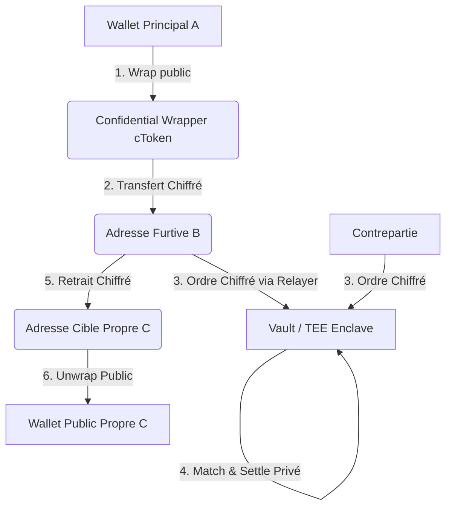

# Nox Dark Pool — Litepaper & Business Plan
*Confidentiality-as-a-Service for Ethereum DeFi powered by iExec Nox (TEEs & Decentralized KMS)*

---

## 1. Executive Summary

### Le Constat
Sur Ethereum et les blockchains publiques équivalentes, toutes les transactions, balances et intentions d’échange (mempool) sont publiques. Cette transparence radicale, autrefois saluée, pose aujourd’hui deux obstacles majeurs à l’adoption institutionnelle et grand public de la DeFi :
1. **Le MEV (Maximal Extractable Value) et le Front-Running** : Les traders perdent chaque année des milliards de dollars à cause de bots d’arbitrage qui anticipent leurs transactions (attaques en sandwich, slippage provoqué).
2. **L’absence de Vie Privée Financière** : N’importe quel concurrent, observateur ou acteur étatique peut analyser les portefeuilles, pister les stratégies de trading et connaître la richesse globale d'une entité.

### La Solution : Nox Dark Pool
Le **Nox Dark Pool** est une plateforme de trading et de transfert EVM-native, 100 % confidentielle et protégée contre le MEV. 
* En combinant des **enclaves matérielles sécurisées (TEEs - Trusted Execution Environments)** et un **système de gestion de clés décentralisé (KMS - Key Management System)** via la technologie **iExec Nox**, le protocole permet d'exécuter des transactions et d'apparier des ordres sans jamais révéler les montants on-chain.
* Grâce à une infrastructure de **Stealth Addresses (adresses furtives)** et de **Relayers**, l'utilisateur peut interagir sans payer de gas et sans laisser de lien public (on-chain) entre son identité principale et ses activités de trading.

---

## 2. Opportunité de Marché & Positionnement

### La Demande Institutionnelle
Dans la finance traditionnelle (TradFi), les **Dark Pools** (places d'échange privées) représentent environ **10 % à 15 % du volume total des échanges d'actions**. Les grandes institutions les utilisent pour exécuter des ordres massifs sans provoquer de panique ou de hausse de prix artificielle sur les marchés publics.

Dans la DeFi actuelle, ce volume est proche de **0 %** en raison du manque d'infrastructures de confidentialité sécurisées et réglementaires. Le Nox Dark Pool ouvre la voie au capital institutionnel sur la blockchain.

### Positionnement Concurrentiel
Les solutions de confidentialité existantes imposent des compromis inacceptables :
* **Les Mixeurs (ex: Tornado Cash)** : Permettent de couper les liens de transactions, mais ne proposent aucun outil de trading (swap/limit orders).
* **Les L1 confidentielles (ex: Secret Network)** : Obligent à utiliser un bridge tiers peu sécurisé pour déplacer ses fonds hors d'Ethereum.
* **Les technologies ZK/FHE pures (ex: Renegade, Fhenix)** : Sont extrêmement lentes (temps de preuve cryptographique de plusieurs secondes/minutes) et coûteuses en calcul.

**Nox Dark Pool** se positionne comme la seule solution **EVM-native, sans bridge, ultra-rapide (vitesse TEE) et intégrant le trading et le mixage de fonds**.

---

## 3. Architecture Technique

Le Nox Dark Pool repose sur quatre piliers technologiques :



### A. Les Wrappers Confidentiels (`ConfidentialToken.sol`)
Pour éviter le besoin d'un bridge, le protocole utilise des wrappers on-chain (`cWETH`, `cUSDC`). L'utilisateur dépose des jetons publics et reçoit en retour des jetons chiffrés sous forme de `euint256`. Les balances et les transferts de ces jetons sont invisibles pour les observateurs extérieurs.

### B. Le TEE Matching Engine (Moteur d'Appariement en Enclave)
Le moteur d’appariement s’exécute au sein d’une enclave matérielle sécurisée (ex: Intel SGX). 
1. L'enclave interroge la blockchain et récupère les ordres soumis (qui contiennent des valeurs chiffrées).
2. Elle obtient la clé de déchiffrement temporaire auprès du Nox KMS (uniquement si les règles d'accès sont valides).
3. Elle déchiffre les montants en mémoire sécurisée (invisible pour l'hébergeur du serveur).
4. Elle apparie les ordres compatibles et soumet une transaction de règlement signée au contrat `DarkPoolVault`.
5. Le contrat valide la signature de l'enclave et met à jour les balances chiffrées. **Les montants réels ne sont jamais écrits en clair sur la blockchain.**

### C. Le Trading Furtif (Stealth Addresses & Relayers)
* **Stealth Addresses** : L'adresse de trading est dérivée localement et de manière déterministe à partir d'une signature du portefeuille principal. Elle n'est jamais stockée et n'a pas besoin de seed phrase distincte.
* **Relayers** : L'adresse furtive détient **0 ETH** de gas. Toutes ses requêtes (dépôts, ordres, retraits) sont signées localement et transmises via HTTP à un Relayer. C'est le Relayer qui soumet la transaction on-chain et paie les frais de gas en ETH, garantissant qu'aucun lien de transaction directe n'existe entre le portefeuille principal et le portefeuille furtif.

### D. Sortie Sécurisée et Propre (Clean Exit)
Lors du retrait, l'utilisateur effectue un transfert chiffré depuis son adresse furtive vers une **adresse de destination propre** de son choix. Cette adresse propre effectue ensuite un `unwrap` public pour récupérer des WETH/USDC normaux. La traçabilité on-chain entre le dépôt initial et le retrait final est totalement rompue.

---

## 4. Modèle Économique & Tokenomics

Le Nox Dark Pool est conçu pour être un protocole auto-suffisant et rentable.

```
+-----------------------------------------------------------+
|                      Frais de Swap                        |
|                                                           |
|    [ Trader ] ---> ( Prélèvement de 0.3% sur le swap )    |
|                               |                           |
|                               v                           |
|       +-----------------------+-----------------------+   |
|       |                                               |   |
|       v                                               v   |
|  [ Relayer ]                                   [ Liquidity ]
|  (Paiement du Gas en jetons)                   (Rémunération des LPs)
+-----------------------------------------------------------+
```

### A. Flux de Frais (Swap Fees)
Chaque transaction exécutée au sein du Dark Pool prélève des frais (ex: **0.30 %** du montant échangé), payés directement dans le jeton échangé (ex: cUSDC ou cWETH).

Ces frais sont divisés en deux catégories :
1. **Frais de Relai (Gas Compensation)** : Une partie des frais sert à rembourser le Relayer pour le gas en ETH qu'il a dépensé. Le Relayer accumule ces jetons et les convertit régulièrement en ETH pour réalimenter son portefeuille.
2. **Incitations de liquidité (LP Yield)** : L'autre partie est distribuée aux fournisseurs de liquidité (LPs) pour les inciter à alimenter les pools privées.

### B. Le Modèle AMM Confidentiel (Pools Privées)
Pour résoudre le démarrage à froid de la liquidité (cold-start) propre aux carnets d'ordres peer-to-peer, le protocole évoluera vers un modèle de **Pool de liquidité privée (AMM)** :
* Les utilisateurs déposent passivement leurs fonds dans des pools.
* Les swaps sont instantanés contre la pool au prix d'un oracle de marché (ex: Chainlink) exécuté dans le TEE.
* Ce modèle garantit une exécution immédiate sans attente de contrepartie, maximisant le volume d'échange et les frais générés.

---

## 5. Feuille de Route Stratégique (Roadmap)

### Phase 1 — MVP & Preuve de Concept (LIVRÉE)
* Développement des contrats intelligents de Vault chiffré et des Wrappers Confidentiels.
* Implémentation du moteur d'appariement TEE en local et intégration avec le Nox KMS.
* Mise en place de la dérivation d'adresse furtive et du service de Relayer gasless.
* Création de l'interface graphique unifiée.

### Phase 2 — TEE Décentralisé & Oracles (Q3 2026)
* Déploiement du moteur d'appariement sur de **véritables workers TEE d'iExec**.
* Intégration de l'attestation on-chain du code de l'enclave (`enclaveAddress` dynamique).
* Mise en œuvre d'oracles de prix TEE-to-Web2 pour empêcher les transactions aberrantes (midpoint pricing).

### Phase 3 — Pools de Liquidité Confidentielles & AMM (Q4 2026)
* Conception et déploiement du modèle **AMM Peer-to-Pool** confidentiel.
* Prélèvement automatique et redistribution des frais de swaps aux LPs et Relayers.
* Standardisation des montants de dépôts (Anonymity Sets) pour bloquer les analyses statistiques de flux.

### Phase 4 — Résilience & Décentralisation (Q1 2027)
* Implémentation de la **sortie de secours trustless** (Emergency Exit) pour parer à toute défaillance matérielle des serveurs TEE.
* Lancement d'un réseau décentralisé de Relayeurs utilisant des protocoles de routage anonyme (type Waku / Tor) pour protéger les IP des utilisateurs.
* Audits de sécurité complets des contrats et de l'enclave.
